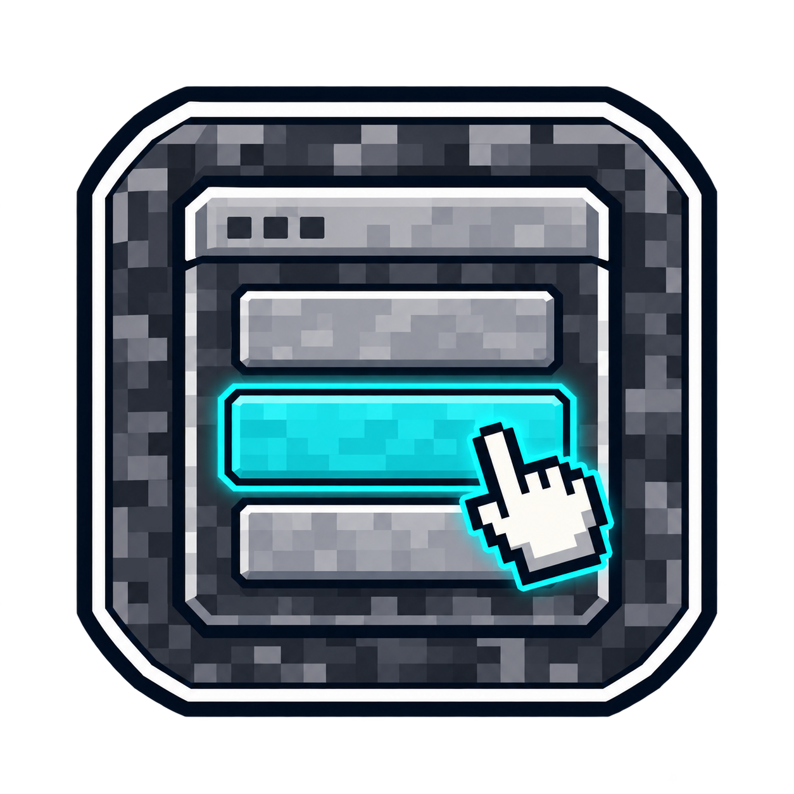

# BedrockAssist

Native **Bedrock menus** (Floodgate forms) for what Geyser cannot translate to Bedrock players on a Java server.
Free. **Java players are never affected**, and it works out of the box.

> **Status:** version 1.0.0 released, download it from [Releases](../../releases/latest).

## Modules

| Module | Geyser limitation | What BedrockAssist does |
|---|---|---|
| Links (`/ba links`) | Bedrock can't open links | Links received in chat (and in plugin messages with PacketEvents) are remembered for 10 minutes and shown in a text field, ready to copy |
| Commands (`/ba commands`) | No command autocompletion | Your list of commands with typed arguments (online players, text, number, choice), then every command the player may use |
| Enchantments (`/ba enchant`) | Levels above vanilla shown wrong (Silk Touch II appears as Silk Touch) | Real enchantments and levels of the item in hand, including datapack and plugin enchantments |
| Anvil and smithing table | Custom recipes don't show | *Combine* menu: pick the items, see the result computed by the server, confirm. Plugins that change anvil results are supported |
| Villagers | On Android and iOS, the first trade is always selected ([Geyser #4102](https://github.com/GeyserMC/Geyser/issues/4102)) | Trade list as a menu, the chosen trade opens normally. Uses, stock, prices and villager XP stay vanilla |

Every module is reachable from the `/ba` menu.

**Copying a link:** the address is selected in the text field even though Bedrock doesn't show it. On PC press
Ctrl+A then Ctrl+C; on a phone, long-press the field.

## Safety

- Anvil and smithing table: the server computes the result on copies of the items. Nothing leaves the inventory
  before the player confirms, and the result is computed again at confirmation
- Villagers: the villager's own trade list is restored when the screen closes, the player leaves, the villager dies
  or the plugin stops
- Protection plugins are respected: a villager your claims plugin forbids stays forbidden
- Commands run with the player's own permissions

## Requirements

- Paper or Folia **1.21.4 → 26.x**, Java 21+ (tested on Paper 1.21.11, Paper 26.3 and Folia 26.3)
- [Geyser and Floodgate](https://geysermc.org/download) on the server
- Optional: [PacketEvents](https://modrinth.com/plugin/packetevents) 2.14+ to catch links sent by plugins
  (`/discord`, `/vote`…). Without it, only player chat is read

## Languages

English and French. Each player gets the menus in the language of their game when it is available, otherwise the
`language` of the config. Texts are in `plugins/BedrockAssist/lang/`: edit them or add your own language, see
[Configuration](docs/configuration.md#languages).

## Documentation

- [Configuration](docs/configuration.md)
- [Commands and permissions](docs/commands.md)

## Support

Report bugs and suggest ideas in [Issues](../../issues). The source code is not public.

## Also by the author

[BedrockGuard](https://github.com/TheMax98000/BedrockGuard): anti-cheat built for Bedrock players on Geyser servers.
